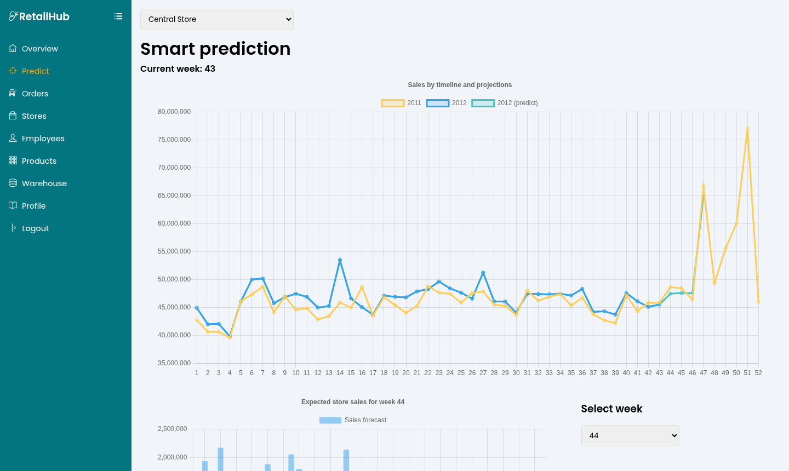
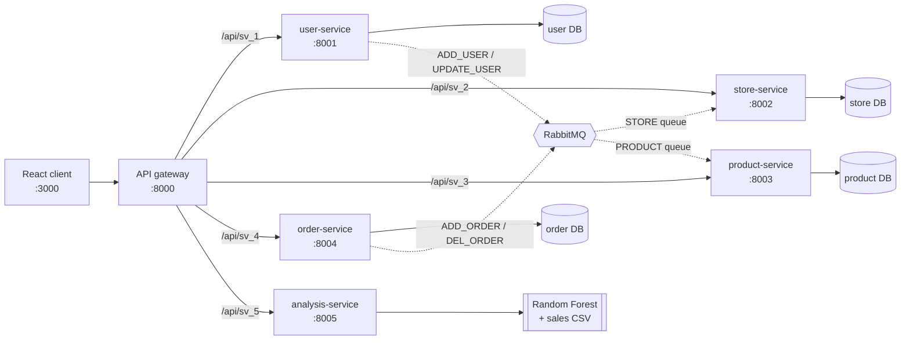
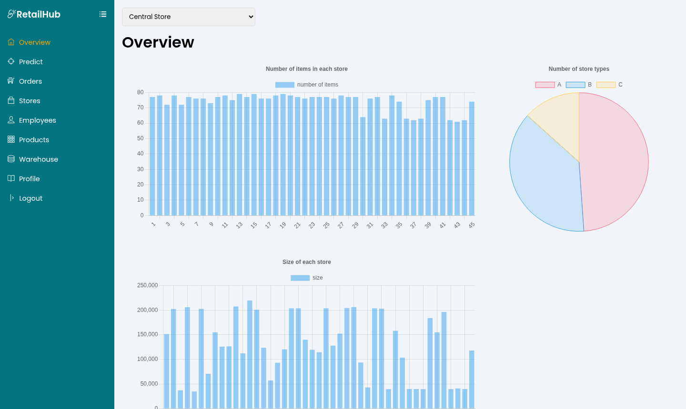
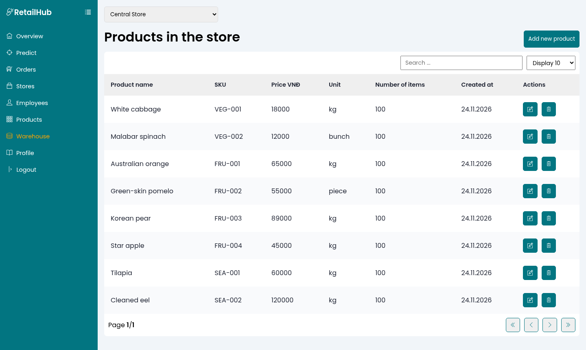

# ERP Microservices — Retail Chain Management with Sales Forecasting

A small ERP system for a multi-store retail chain, built as a set of independent
microservices. It covers staff and role management, stores, products and per-store
stock, sales orders, and a machine-learning service that forecasts weekly sales for
the next four weeks.

Built for the *Information Systems Integration* university course (2022), the project
shows the main integration patterns from that course: an API gateway,
database-per-service, and asynchronous events over a message broker.



## Features

- **Authentication and roles**: JWT login with four roles (director, store manager, cashier, employee) and role-based access to user and store management.
- **Stores and staff**: CRUD for stores and employees. Each store's employee counter is kept in sync through events.
- **Catalogue and stock**: products with photos, categories, and stock items per store.
- **Orders**: creating or deleting an order publishes an event that updates stock in the product service.
- **Analytics dashboard**: historical sales per store, department and store type.
- **Sales forecasting**: a Random Forest model predicts weekly sales per store and department for the next 4 weeks.

## Architecture



| Service | Stack | Responsibility |
|---|---|---|
| `api-gateway` | Express, express-http-proxy | Single entry point; routes `/api/sv_N/*` to the services |
| `user-service` | Express, MongoDB, bcrypt, JWT | Users, roles, login; publishes user events |
| `store-service` | Express, MongoDB | Stores; consumes user events to update employee counts |
| `product-service` | Express, MongoDB | Products, categories, stock items; consumes order events |
| `order-service` | Express, MongoDB | Sales orders; publishes order events |
| `analysis-service` | Flask, pandas, scikit-learn | Sales statistics and 4-week forecast |
| `client` | React 17, Redux Toolkit, Chart.js, styled-components | Admin dashboard |

Each Node service owns its own MongoDB database. The services never read each other's
data directly. They stay consistent through RabbitMQ events.

## Quick start (Docker)

Requirements: Docker with the Compose plugin.

```bash
git clone https://github.com/weedharm/Information_Systems_Integration.git
cd Information_Systems_Integration
cp .env.example .env          # optional: change JWT_SECRET / DEMO_PASSWORD
docker compose up --build
```

The first build takes a few minutes, mostly to build the React app and train the
forecasting model. Then open:

| URL | What |
|---|---|
| http://localhost:3000 | Web dashboard |
| http://localhost:8000/api | API gateway |
| http://localhost:15672 | RabbitMQ management UI (`guest` / `guest`) |

**Demo accounts** (created automatically on start-up):

| Email | Password | Role |
|---|---|---|
| `director@erp.local` | `admin123` | Director (full access) |
| `manager@erp.local` | `admin123` | Store manager |

The seed scripts also create two stores, three categories and eight products with
stock. Run `docker compose down -v` to stop everything and wipe the data.

## Running a service without Docker

Each Node service reads its settings from environment variables and falls back to a
local MongoDB (`mongodb://localhost:27017/<service>`) and RabbitMQ (`amqp://localhost:5672`).

```bash
docker compose up -d mongo rabbitmq   # or use your own instances

cd user-service
npm install
npm run seed      # demo roles and users (user-, store- and product-service have seeds)
npm run dev       # nodemon; `npm start` runs plain node
```

Analysis service (Python 3.10+):

```bash
cd analysis-service
pip install -r requirements.txt
python train_model.py   # writes model/random_forest.joblib (~40 MB)
python app.py           # http://localhost:8005
```

Client (react-scripts 4 needs **Node 16**):

```bash
cd client
npm install
REACT_APP_API_URL=http://localhost:8000 npm start
```

### Configuration

| Variable | Used by | Default |
|---|---|---|
| `JWT_SECRET` | all Node services | `dev-only-secret-change-me` |
| `MONGO_URI` | user/store/product/order | `mongodb://localhost:27017/<service>` |
| `AMQP_URL` | user/store/product/order | `amqp://localhost:5672` |
| `DEMO_PASSWORD` | user-service seed | `admin123` |
| `*_SERVICE_URL` | api-gateway | `http://localhost:800N` |
| `DATA_DIR`, `MODEL_PATH` | analysis-service | `../model-training`, `model/random_forest.joblib` |
| `REACT_APP_API_URL` | client (build time) | `http://localhost:8000` |

## API

All requests go through the gateway at `http://localhost:8000/api`:

| Prefix | Service | Main endpoints |
|---|---|---|
| `/sv_1` | user | `POST /login`, `GET /current`, `/users`, `/roles` |
| `/sv_2` | store | `/stores` |
| `/sv_3` | product | `/products`, `/categories`, `/items`, `/items/in-store/:storeId` |
| `/sv_4` | order | `/orders`, `/orders/in-store/:storeId` |
| `/sv_5` | analysis | `/analysis/truth/*`, `/run/predict`, `/analysis/predict/*` |

Protected endpoints expect `Authorization: Bearer <token>`. Ready-to-run examples are
in [`requests.http`](requests.http) (VS Code *REST Client* extension).

## Sales forecasting model

- **Data**: [Walmart Recruiting — Store Sales Forecasting](https://www.kaggle.com/c/walmart-recruiting-store-sales-forecasting) (45 stores, ~420k weekly sales rows from 2010-02 to 2012-10), stored in [`model-training/`](model-training).
- **Features**: store, department, holiday flag, store size, store type, ISO week, and year.
- **Model**: `RandomForestRegressor` (30 trees, max depth 20), trained by [`analysis-service/train_model.py`](analysis-service/train_model.py). The exploration notebook is [`model-training/random_forest.ipynb`](model-training/random_forest.ipynb).
- **Metric**: WMAE (weighted MAE, where holiday weeks count 5×). The model scores about **1,680 on a 20% hold-out set**.
- Because the dataset ends at week 43 of 2012, the service treats that week as "now" and forecasts weeks 44–47, which include Thanksgiving.

## Project structure

```
├── api-gateway/        Express reverse proxy
├── user-service/       users, roles, auth (+ seeders/)
├── store-service/      stores (+ seeders/)
├── product-service/    products, categories, stock (+ seeders/, public/uploads/)
├── order-service/      orders
├── analysis-service/   Flask API + train_model.py
├── model-training/     dataset and exploration notebook
├── client/             React dashboard
├── docker-compose.yml
└── requests.http       example API calls
```

## Screenshots

| Overview | Store stock |
|---|---|
|  |  |
